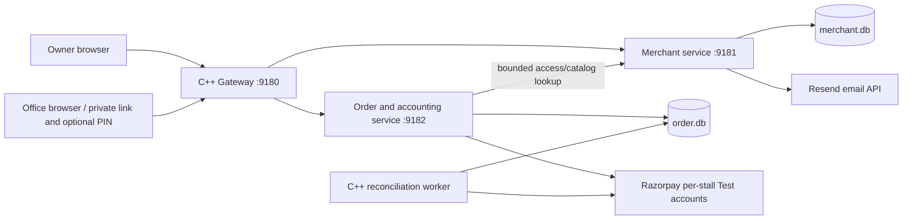

# Architecture: Phase 1/2 implementation

Merchant owns accounts, sessions, verification challenges, stalls, hours, menu,
offices, links/PINs and current policy. Order owns basket/price/address/policy
snapshots, reservations, ledger, allocations, statements, provider identifiers and
recovery state. Gateway serves static assets and routes HTTP; it never reads SQL.
Each service accesses only its own database. Financial and fulfilment writes stay
in one local transaction rather than requiring a distributed SQL transaction.

## Implementation modules

- common/core.h: RAII SQLite handles/transactions, prepared statements, validation,
  money bounds, crypto, bounded libcurl calls and fixed IST month boundaries.
- merchant/merchant.h: additive schema upgrades, access, challenge verification,
  rate limiting, office/catalog DTOs and opening-day/time checks.
- merchant/main.cpp: owner-facing routes and audited versioned configuration.
- order/repository.h: durable snapshots, reservation/debt calculations and allocation.
- order/billing.h: receipts, reversals, adjustments and monthly statements.
- order/payments.h: per-stall adapter, setup/capture/refund recovery and worker.
- order/main.cpp: basket/order/status/payment/webhook application routes.
- frontend/: browser portals with no customer installation, opt-in sound and polling.

## Critical invariants

Server credential lookup selects the office/stall. The browser does not select
identity or authoritative prices. Basket fingerprinting is office-scoped and
normalizes item quantities. A write transaction checks idempotency, pending
reservations and unpaid fulfilled charges before inserting the order and items.

Monthly fulfilment atomically replaces a reservation with a ledger charge.
Receipts and credit notes allocate against fulfilled charges; overpayments are
rejected. Reversals append compensating entries and allocations. Ledger,
allocations, statements and audit have update/delete-blocking triggers. An admin
with schema control remains outside this local immutability guarantee.

Closed India calendar months produce unique office/month statements referencing
charges without adding debt. Allocated unpaid statement lines determine overdue
credit. Current policy can block new credit but never rewrites prior order terms.
Availability is a toggle, not unit-level stock reservation; area is an owner-
approved exact label, not a GPS/geofence calculation.

Prepaid requests remain PAYMENT_PENDING until valid HMAC and canonical provider
capture checks succeed. Capture after cancellation records refund liability and
does not reopen fulfilment. Refund completion requires canonical processed status.
Provider calls occur outside write locks. Setup ambiguity uses receipt lookup;
refund ambiguity uses a stable provider idempotency key.

The worker persists retry/lease state in Order's DB, uses capped backoff, and
recovers captures/refunds without browser callbacks. A stale worker cannot overwrite
a newer scheduling lease. Financial idempotency still matters because work can
overlap after a lease expires. This is a durable local worker, not a Kafka/outbox
publisher or an exactly-once distributed protocol.

## Verification and access

Salted PBKDF2 protects passwords/PINs; random session and office tokens are hashed
at rest. Email challenges are keyed hashes bound to subject, email and expiry,
with bounded attempts and atomic consumption. Owner sessions expire and can be
revoked. Office links remain bearer capabilities without individual employee
identity; optional PIN and link rotation are explicit controls.

Internal calls require a runtime secret and loopback/private deployment. This is
not mTLS. Provider account files stay outside Git; only Test key IDs are accepted.
Normal startup cannot claim payment/verification success with missing credentials.
The separate tests/ provider server is never started by scripts/dev.py.

## Tradeoffs and limits

- SQLite serializes writers across unrelated offices. No throughput claim is made.
- Merchant lookups precede Order commits. Policy/link/menu changes have lookup-time
  snapshot semantics; stronger immediate revocation needs an explicit version or
  ownership/reservation protocol. No distributed transaction is implied.
- Shared office access and browser sessionStorage need production session/privacy
  hardening. No recovery/MFA, deployment TLS or full distributed rate limit exists.
- Foreground polling/sound do not guarantee background delivery on actual phones.
- Additive schema upgrades and offline restore are tested; large online migration
  rollback, encrypted scheduled backups and deployment failover remain operations work.
- No tax invoice configuration, real pilot, merchant onboarding/settlement approval,
  real-provider certification, load/soak evidence or independent release review.

For a tiny team, a modular monolith could reduce operations cost. These service
boundaries support the requested microservices study goal; they do not prove this
business requires microservices. PostgreSQL, tracing, connection pools, SSE, queues,
external audit storage and multi-node deployment should follow measured needs.

See OPERATIONS.md, PHASE_1_2_ACCEPTANCE.md and interview/FINANCIAL_WORKFLOWS.md.
