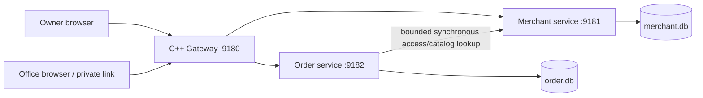

# Architecture: implemented design and intended evolution

## Current deployment

Three independent C++ executables use Crow HTTP routing. Merchant owns owner
credentials, sessions, stalls, menu and office access/policy. Order owns order
snapshots, credit commitments, status/version and state-change events. Gateway
serves the frontend and routes same-origin API requests; it does not query either
database. Only Merchant reads merchant.db; only Order reads order.db.

The same SQLite engine and machine are shared infrastructure, not a shared
logical database. There are no cross-service SQL joins or foreign keys. One
office per link is the access unit; employees are not individually identified.

## Why these boundaries?

Owner/catalog changes and transactional order handling have different lifecycles.
Order must serialize spending decisions for an office. Keeping credit usage and
orders in one transaction avoids a distributed transaction for the critical
invariant. Menu/policy still come from a synchronous Merchant lookup.

Costs of microservices already visible: an Order request can fail when Merchant
is unavailable, there is another HTTP hop, and policy can change between lookup
and commit. For a tiny commercial team a modular monolith could cost less to
operate. This split deliberately supports the user's C++ microservices learning
goal; it is not evidence that microservices are universally necessary.

## Consistency and failure behaviour

Order creation resolves the office token and menu, begins `BEGIN IMMEDIATE`,
checks a unique office/idempotency key, sums unpaid non-cancelled commitments,
checks available credit, and inserts the order plus event before commit. A
PLACED request reserves credit before acceptance so simultaneous requests cannot
oversubscribe. Cancellation releases that commitment. Fulfilment does not mark
payment received. No payment/settlement mutation exists yet.

Prices and payment policy are snapshots. Unknown browser identity/total fields
do not grant authority. A retry with the same semantic item/quantity and key
returns the original order; reuse with a different payload returns 409. Replays
still require a currently valid link and available Merchant service.

Status updates validate the transition and expected version inside a transaction.
Terminal orders cannot reopen. State events commit with their order mutation,
but are not a published event stream or transactional outbox worker.

Dependency requests have connect and total timeouts and fail closed. There are
no automatic HTTP retries or circuit breaker yet. Gateway liveness does not
prove downstream readiness; Merchant and Order health handlers query their own
database. SQLite contention that exceeds its timeout currently becomes a generic
500, not a specialized retryable error.

## Security and operational limits

- PBKDF2-HMAC-SHA256 with per-account random salt and 600,000 iterations;
  opaque 256-bit random sessions with one-day expiry and hashed storage.
- Office tokens use 256-bit randomness, hashed storage, and explicit rotation.
- Prepared statements; owner/stall and office scopes are resolved on the server.
- Internal access uses a runtime random shared key. Loopback binding limits local
  exposure; it is not a substitute for private networking or mTLS on other hosts.
- Prototype does not verify email/contact ownership, throttle login, provide MFA,
  issue HTTPS certificates, implement account recovery, or expire office links.
- Public access logs must not include sensitive headers/bodies. Never put tokens
  in query strings. Seller sessionStorage is exposed to same-origin script and
  must be revisited with CSP and secure cookie/session design before deployment.
- Request body validation occurs in handlers after HTTP parsing. Proxy/server
  connection/body limits are still needed for hostile traffic.
- No backup/restore drill, production migrations, load test, or external review.

## Evolution decisions, not implemented features

1. Finish office verification, address/hours/stock rules, policy changes and
   persisted audit actor/reason before onboarding real offices.
2. Add append-only ledger allocations, invoices and reconciliation. Keep credit
   reservation and ledger invariants in one service-owned transaction.
3. Integrate verified payment callbacks with unique provider event IDs and
   idempotent handling; use a durable outbox and retry worker for notifications.
4. Move to PostgreSQL when measured write concurrency, operations, or deployment
   needs justify it; use per-office row locking and unique constraints.
5. Use broker consumers with at-least-once delivery and deduplication when async
   work warrants the operational cost. Do not claim end-to-end exactly-once.
6. For horizontal scale, remove node-local DB dependence, use load balancing,
   private network identity, bounded pools, tracing and deploy rollback.

Redis, Kafka, Kubernetes, CQRS infrastructure, sagas and sharding are not present.
Each needs a concrete problem and evidence before being added.
